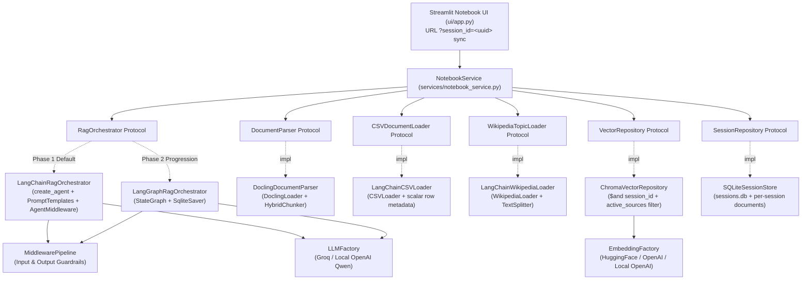

# Low-Level Design (LLD) — Agentic RAG Notebook

## 1. Architectural Overview (SOLID & KISS)

The codebase follows a clean layered architecture where high-level orchestration and UI depend strictly on domain abstractions (`typing.Protocol`), never on concrete vendor SDKs:

## 2. SOLID Mapping

| Principle | Where Applied |
| :--- | :--- |
| **Single Responsibility (SRP)** | `DoclingDocumentParser` parses PDFs; `LangChainCSVLoader` loads CSV rows via `CSVLoader`; `LangChainWikipediaLoader` fetches & splits articles via `WikipediaLoader`; `ChromaVectorRepository` stores/filters session vectors; `SQLiteSessionStore` persists chats & per-session sources; `MiddlewarePipeline` enforces guardrails; `NotebookService` coordinates workflows. |
| **Open/Closed (OCP)** | New input/output guardrails implement `InputGuardrail` / `OutputGuardrail` and plug into `MiddlewarePipeline`. New source loaders or LLM/embedding providers implement focused Protocols without rewriting orchestrators. |
| **Liskov Substitution (LSP)** | `LangChainRagOrchestrator` and `LangGraphRagOrchestrator` both satisfy `RagOrchestrator` and return the identical `AgentResponse` contract. |
| **Interface Segregation (ISP)** | `DocumentParser`, `CSVDocumentLoader`, `WikipediaTopicLoader`, `VectorRepository`, `SessionRepository`, and `RagOrchestrator` stay small and focused on one capability. |
| **Dependency Inversion (DIP)** | `services/` and `orchestration/` import `domain/interfaces.py` and `domain/models.py`, injected at startup. |

## 3. Vector Metadata & Strict `session_id` Isolation

Every chunk written to ChromaDB includes flat scalar metadata (`str | int | float | bool`):
- Core fields: `session_id`, `source`, `source_type` (`pdf` | `csv` | `wikipedia`), `filename`, `url`, `title`, `page`, `row`, `heading`, `chunk_index`, `ingested_at`.
- Source-specific scalars: `ocr_enabled` (PDF), `csv_<col>` / `csv_source_value` (`CSVLoader`), `wiki_summary` / `wiki_categories` / `wiki_sections` / `wiki_revision_id` (`WikipediaLoader`).
- ChromaDB vector IDs are scoped as `{session_id}::{source}::chunk_{chunk_index}`, and `similarity_search` always applies `{"session_id": session_id}` (combined with `active_sources` via `$and`) so separate URL sessions never cross-match vectors.

## 3. Request Lifecycle

1. **Session Sync**: UI reads `?session_id=<uuid>` from `st.query_params` (or generates a UUID4 session ID and writes it to the URL).
2. **Input Middleware**: Validates length, blocks prompt injection attempts, and redacts PII before reaching the model.
3. **Agentic Retrieval**:
   - **LangChain Mode**: `create_agent` decides when to invoke `search_knowledge_base` / `list_active_sources` using modular `ChatPromptTemplate` context and `SQLChatMessageHistory`.
   - **LangGraph Mode**: `StateGraph` executes `route -> retrieve -> grade_documents -> rewrite_query -> generate` with `SqliteSaver`.
4. **Output Middleware**: Redacts leaked keys/secrets, checks unsafe outputs, and validates groundedness/citations against retrieved chunks.
5. **Persistence**: User prompt, assistant answer, Qwen `<think>` reasoning, citations, and guardrail report are persisted to SQLite under `session_id`.
