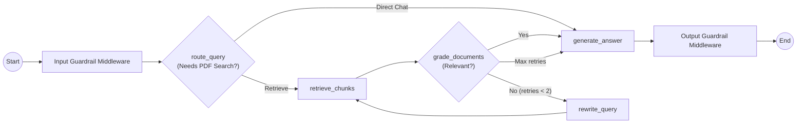

# Learning Path: From LangChain Orchestration to LangGraph

This project is structured intentionally in two clear phases so you can master **LangChain v1 orchestration + built-in middlewares** first, and then explore **explicit LangGraph `StateGraph` control** without rewriting your UI, storage, or guardrails.

## Phase 1 (Default): LangChain Orchestration (`ORCHESTRATION_ENGINE=langchain`)

File: `src/agentic_rag_notebook/orchestration/langchain_agent.py`

Key concepts demonstrated:
1. **Model Factory (`infrastructure/llm_factory.py`)**: Swap between `ChatGroq` and local Qwen via `ChatOpenAI(base_url=..., api_key=...)` using `.env`.
2. **Modular Prompt Templates (`prompts/templates.py`)**: Keep system instructions and RAG guidance clean and testable using `ChatPromptTemplate`.
3. **Tools (`orchestration/tools.py`)**: `@tool` functions (`search_knowledge_base`, `list_active_sources`) with request-scoped citation collection.
4. **Built-in LangChain Middlewares (`middleware/langchain_adapter.py`)**:
   - `PIIMiddleware` (built-in redaction for email, credit card, IP, and custom `api_key` regex)
   - `SummarizationMiddleware` (built-in long-conversation summarization)
   - `ModelCallLimitMiddleware` & `ToolCallLimitMiddleware` (built-in agent loop guards)
   - `ToolRetryMiddleware` (built-in transient error retries)
   - Plus `LangChainGuardrailMiddleware` (`AgentMiddleware`) for RAG-specific prompt-injection blocking (`before_agent`) and citation groundedness auditing (`after_agent`).
   - *Tip*: You can also add LangChain's `HumanInTheLoopMiddleware(interrupt_on={...})` alongside a LangGraph checkpointer when interactive tool approval is desired.
5. **Session Memory (`infrastructure/sqlite_session_store.py`)**: `BaseChatMessageHistory` backed by SQLite tied to the URL `?session_id=<uuid>`.

## Phase 2: Explicit LangGraph Workflow (`ORCHESTRATION_ENGINE=langgraph`)

File: `src/agentic_rag_notebook/orchestration/langgraph_agent.py`

Once comfortable with Phase 1, switch `ORCHESTRATION_ENGINE=langgraph` in `.env` (or in the Streamlit sidebar) to explore explicit graph orchestration:

Notice how **zero UI or database code changes** between Phase 1 and Phase 2 because both implement the `RagOrchestrator` Protocol!
